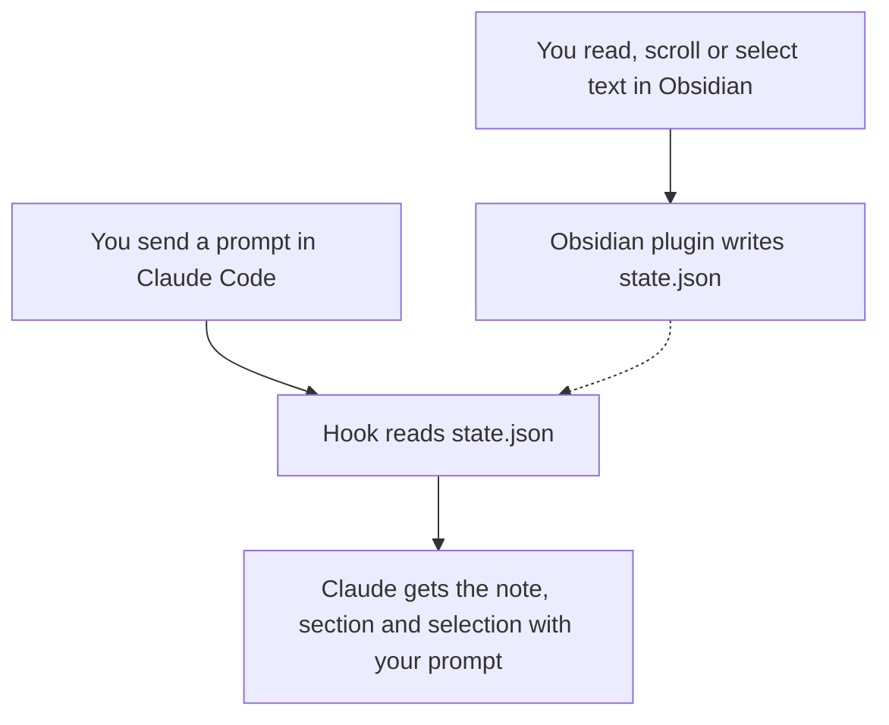

# Claude Code Connector for Obsidian

Ask Claude Code about the note you are reading without pasting it in.

Claude Code's VS Code extension tells Claude which file you have open and what
you selected. This does the same for Obsidian. Read a note, select a paragraph,
switch to your terminal and ask *"what does this mean?"* Claude already knows
which note, which section and which lines you mean.

It has two halves that talk through one small file:

| Half | Lives in | Does |
| --- | --- | --- |
| **Claude Code Connector**, an Obsidian plugin | your vault | writes what you are reading to `~/.claude/obsidian-context/state.json` |
| **obsidian-context**, a Claude Code plugin | Claude Code | adds that to your prompt, as a short block Claude reads |



## What Claude sees

With a paragraph of a cooking note selected, your prompt arrives with this
block attached:

```text
<obsidian-context>
What the user has open in Obsidian (updated 2 min ago). Use it to work out what
"this", "here" or "this note" means in their message; ignore it when the message
is about something else. Read the note for its full text.
Vault: notes (note paths below are inside it)
Reading: guides/Cooking basics.md (reading view)
Section: Cooking basics > Knife skills
Selected text (lines 14-15):
<selection>
Keep the tip of the knife on the board.
</selection>
Other open tabs: Index.md
Recently opened: guides/Bread.md (09:30)
</obsidian-context>
```

It is sent once and again only when something changes, so asking three
questions about the same paragraph does not repeat it three times.

## Install

You need both halves, a desktop Obsidian (1.5 or newer) and
[Node.js](https://nodejs.org) 20 or newer on your `PATH` (the hook runs with
`node`).

### 1. The Obsidian plugin

The plugin is not in Obsidian's Community plugins list yet. Until it is, use
either of these:

- **By hand:** download `main.js` and `manifest.json` from the
  [latest release](https://github.com/SigniorAtif/Obsidian-CC-connector/releases/latest)
  into `<your vault>/.obsidian/plugins/claude-code-connector/`. In Obsidian,
  open **Settings → Community plugins**, turn community plugins on, click the
  refresh icon next to **Installed plugins** and switch on
  **Claude Code Connector**.
- **With [BRAT](https://github.com/TfTHacker/obsidian42-brat):** add the beta
  plugin `SigniorAtif/Obsidian-CC-connector`. BRAT also keeps it up to date.

The status bar now shows **Claude: sharing**.

### 2. The Claude Code plugin

In Claude Code:

```text
/plugin marketplace add SigniorAtif/Obsidian-CC-connector
/plugin install obsidian-context@obsidian-cc-connector
```

Start a new session. That's it.

## When Claude gets the context

The hook adds the block to a prompt only when all of these hold:

1. **Obsidian is running** with the plugin on and not paused.
2. **The session is in the right folder.** By default that is the vault itself
   or, if the vault sits inside a git project, anywhere in that project. A
   Claude Code session about some unrelated project gets nothing. To share
   with every session, turn on **Share with every Claude Code session** in the
   plugin's settings.
3. **Something changed** since the last prompt of that session. Starting,
   resuming, clearing or compacting a session sends it again.

## Using it

- **Pause:** click **Claude: sharing** in the status bar, run
  **Claude Code Connector: Pause or resume sharing** from the command palette,
  or switch off **Share with Claude Code** in the plugin's settings. Pausing
  deletes the state file at once.
- **Selections** are read in editing and reading view, with the source line
  numbers. In other views, such as PDFs, the plugin shares the selected text
  when it can see it, without line numbers. Selections over 4,000 characters
  are cut short, and Claude is told.
- **Where you are** without a selection is the heading above the first line
  on screen.

## Privacy

- The Obsidian plugin makes **no network requests** and collects no
  telemetry.
- It **writes one file outside your vault**:
  `~/.claude/obsidian-context/state.json`. The file holds the path of the open
  note, the headings above where you are, the text you selected, the paths of
  your open tabs and of the last ten notes you opened. It is deleted when you
  pause or disable the plugin and when Obsidian's window closes. If Obsidian
  crashes and leaves it behind, the hook sees that Obsidian is no longer
  running and ignores it.
- It keeps your recent-notes list and settings in its own `data.json` inside
  the vault, like any plugin.
- The Claude Code hook only reads that file. What it adds to a prompt is sent
  to Anthropic (or the provider your Claude Code uses) along with the prompt,
  exactly as if you had typed it. Pause the plugin before reading anything you
  do not want to share.

## Settings

| Setting | Default | What it does |
| --- | --- | --- |
| Share with Claude Code | on | Off pauses sharing, the same as clicking the status bar item. |
| Share with every Claude Code session | off | On lets sessions in any folder see what you are reading. |

To move the state file, set the environment variable `OBSIDIAN_CONTEXT_DIR`
for **both** Obsidian and Claude Code, for example in your shell profile
(then start Obsidian from that environment).

## Limits

- **Desktop only.** The plugin writes a file with Node's `fs`, which mobile
  Obsidian does not have.
- **One vault at a time.** If two vaults are open, the one you used last
  wins.
- **Reading-view line numbers** come from Obsidian internals that are not part
  of its public API. If an Obsidian update changes them, you still get the
  selected text, just without line numbers.
- Tested on Obsidian 1.14.4 and Claude Code 2.1 on Linux. The hook's tests
  also run on macOS and Windows in CI.

## Troubleshooting

- **No "Claude: sharing" in the status bar:** the plugin is not enabled. Check
  **Settings → Community plugins**, and click the refresh icon if it is
  missing from the list.
- **Claude does not seem to know:** check that `~/.claude/obsidian-context/state.json`
  exists and changes when you switch notes. If it does, check you started
  Claude Code inside the vault or its project, or turn on **Share with every
  Claude Code session**. Run `/plugin` in Claude Code to see that
  `obsidian-context` is enabled.

## Contributing

Bug reports and pull requests are welcome. See [CONTRIBUTING.md](CONTRIBUTING.md)
for the setup, the checks and how releases are made.

## License

[MIT](LICENSE) © 2026 Atif Ahmed
